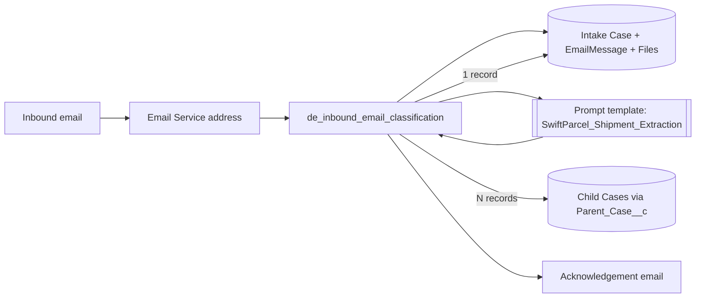

# Inbox Sort

An Apex **Email Service** that reads inbound customer emails (body, screenshots, spreadsheets), uses an Einstein prompt template to extract shipment details, and creates and routes Cases, for the fictional courier *SwiftParcel*.

## What it does

`de_inbound_email_classification` implements `Messaging.InboundEmailHandler`:

1. Creates an intake **Case** from the email subject and body and logs the email as an `EmailMessage`.
2. Saves attachments (binary and text) as Files linked to the Case; `.xlsx` sheets are unzipped and read as text.
3. Sends subject, body and attached image to the `SwiftParcel_Shipment_Extraction` **prompt template**, which returns a JSON array of `{name, mobileNumber, awbNumber, email, description}`.
4. **Single shipment** (e.g. one tracking screenshot): populates the intake Case. **Many rows** (e.g. an NDR sheet): keeps the intake Case as parent and creates one child Case per shipment via `Parent_Case__c` (capped per email).
5. Replies to the sender with the Case number(s) and recognised AWB number(s).

The prompt call sits behind an extractor seam (`setExtractor()`), so tests run without calling the LLM.

## Architecture



## Components

| Component | Purpose |
|---|---|
| `classes/de_inbound_email_classification` | Email handler, xlsx text extraction, extractor seam, reply |
| `genAiPromptTemplates/SwiftParcel_Shipment_Extraction` | Flex prompt template that extracts shipment records |
| `objects/Case/fields/AWB_Number__c`, `Parent_Case__c` | Tracking number and parent/child link |
| `permissionsets/SwiftParcel_Shipment_Support` | Field access for support agents |

## Prerequisites

- Salesforce CLI; an org with Service Cloud (Cases, Email-to-Case) and Einstein Generative AI / Prompt Builder enabled.

## Setup and deploy

```bash
sf project deploy start --source-dir force-app --target-org <alias>
```

Then in Setup > **Email Services** create a service for the Apex class `de_inbound_email_classification`, add an email address, and send mail to the generated address.

## Configuration

- Activate the prompt template in Prompt Builder and confirm its developer name matches `TEMPLATE_NAME` in the class.
- Assign the `SwiftParcel_Shipment_Support` permission set to support users; set the Email Service's running user.
- The reply text and sender signature are in the handler; adjust for your team.

## Screenshots

Add screenshots to `docs/screenshots/`.

## License

MIT, see [LICENSE](LICENSE).
